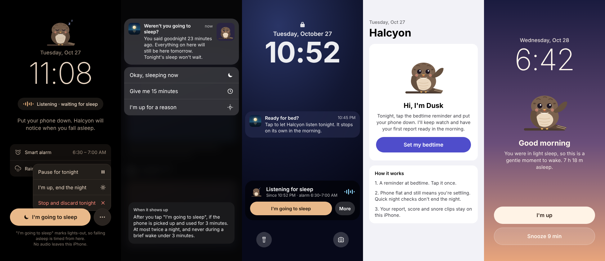

<h1 align="center">Halcyon</h1>

A free, private sleep tracker for iPhone. Put your phone down; Dusk keeps watch.

> **Beta.** Thanks for testing. Please tell me what works, what doesn't and what feels off. See [Giving feedback](#giving-feedback).

## What it does

- **Notices sleep on its own.** Tap the bedtime reminder once. When the phone lies flat and still, Halcyon starts timing your sleep. Checking the time or a bathroom trip doesn't end the night; using your phone in the morning does.
- **A detailed morning report.** Minute-by-minute stages (Awake, REM, Core, Deep), when you fell asleep, wake-ups, and a timeline of what happened in the night.
- **A sleep score out of 100**, split into five parts: duration, unbroken sleep, regularity (Sleep Regularity Index), depth and how fast you fell asleep.
- **Snoring, sleep talk and coughs**, with short clips you can play back. Clips are kept for 30 days.
- **A gentle smart alarm** that wakes you in light sleep inside a window you choose.
- **A friendly nudge** if you said you were going to sleep and are still scrolling.
- **Apple Health.** It can save your nights to Health and read Apple Watch stages and heart rate if you have them.
- Trends, sleep debt, steady-bedtime streaks, light and dark mode.

## Privacy

Everything stays on your iPhone. There is no account, no server and no analytics. Sound is analysed on the device with Apple's built-in classifier, and the only clips saved are the short ones you see in the app. If you turn on Apple Health, nights are written to Health on your phone. Read more in [PRIVACY.md](PRIVACY.md).

## Install (free)

Halcyon is free and isn't on the App Store. You install it with **SideStore**, a free app that signs Halcyon with your own Apple ID.

**You need:** an iPhone on iOS 18 or newer, a free Apple ID, and a Mac or Windows PC **once, for about 10 minutes**. A friend's computer is fine. After setup, you install, update and refresh everything on the phone.

### One-time setup (about 10 minutes)

1. Follow the official SideStore install guide at **[docs.sidestore.io](https://docs.sidestore.io)**. It walks you through connecting your iPhone to the computer once and putting SideStore on the phone.
2. On the iPhone, turn on **Settings › Privacy & Security › Developer Mode** and restart when asked.
3. If iOS says the developer is untrusted, go to **Settings › General › VPN & Device Management**, tap your Apple ID and tap **Trust**.

You can put the computer away now.

### Install Halcyon (on the phone)

1. Open SideStore › **Sources** › **+** and paste:
   `https://raw.githubusercontent.com/mrdebayanD/halcyon/main/altstore-source.json`
2. Find **Halcyon** in the source and tap **Get**.

New beta builds then show up in SideStore's **Updates**. Or download [Halcyon.ipa](https://github.com/mrdebayanD/halcyon/raw/main/beta/Halcyon.ipa) in Safari and install it from **My Apps › +**.

### Every 7 days

Apps signed with a free Apple ID expire after 7 days. SideStore refreshes Halcyon in the background. If Halcyon ever stops opening, open SideStore and tap **Refresh All**. Your nights are kept.

A free Apple ID can have 3 sideloaded apps at a time, and SideStore counts as one of them.

**Prefer AltStore?** It works too with the same source link, but it needs your computer on the same Wi-Fi to refresh. See [altstore.io](https://altstore.io).

### Build it yourself

Open `Nidra.xcodeproj` in a recent Xcode (built with Xcode 27), choose your team under **Signing & Capabilities** for both targets (Nidra and NidraWidgets), pick your iPhone and press Run. (The project folders still use the app's old working name, Nidra.)

## Using it

1. Allow microphone, motion, notifications and (optionally) Health when asked.
2. Set a bedtime reminder in **Settings**.
3. At bedtime, tap the reminder. Halcyon opens and starts listening.
4. Tap **I'm going to sleep** and put the phone down, ideally flat on the bed or nightstand and charging.
5. In the morning, pick up your phone. Your report is ready a minute later.

iOS only allows the microphone to start while the app is open, which is why you tap the reminder once each night. **Stay armed all day** in Settings removes that tap, at the cost of battery and the orange mic dot.

## Giving feedback

Inside the app: **Settings › Send feedback or report a bug**. Or go straight to [New issue](https://github.com/mrdebayanD/halcyon/issues/new/choose) and pick:

- **Bug report**: something broke or crashed.
- **Sleep accuracy**: the report didn't match your night.
- **Idea or feedback**: anything else, including how it feels to use.

GitHub issues are public. Don't paste anything private, and don't attach sound clips unless you're happy for others to hear them. A screenshot of the report is usually enough.

## License

[MIT](LICENSE) © 2026 Debayan Datta. Free to use, share and change.
